# BlueROV2 Sensor Integration Modules

**Underwater robotics · Mechanical design · CAD · Rapid prototyping · Sensor integration**

This repository documents the **mechanical design, CAD modelling, prototyping, and integration** of two custom sensor-mounting systems for the **BlueROV2** remotely operated underwater vehicle, developed during a research internship at **POSTECH Hazardous and Extreme Environment Robotics (HERO) Lab**.

The two projects are a **two-axis underwater laser camera pan–tilt mount** and a **modular Oculus M1200d imaging sonar mount** with configurations for 45° and 90° sonar beam orientations. The work focused on translating sensor-integration requirements into manufacturable mechanical components and installed hardware.

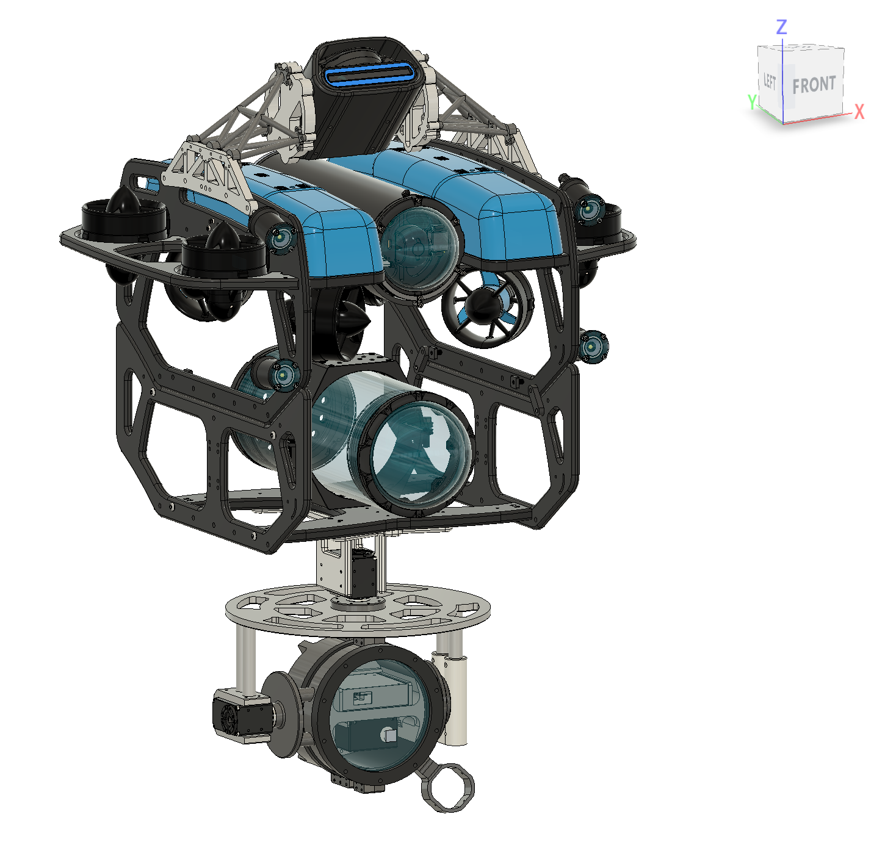

## Overview

| Project | Purpose | CAD models |
|---|---|---|
| [Two-Axis Laser Camera Pan–Tilt Mount](#1-two-axis-underwater-laser-camera-pan-tilt-mount) | Support and orient an underwater laser camera beneath the ROV | 6 STEP parts |
| [Modular Oculus M1200d Imaging Sonar Mount](#2-modular-oculus-m1200d-imaging-sonar-mount) | Integrate an imaging sonar with reconfigurable mounting geometry | 7 STEP parts |

**My work:** Mechanical CAD design, fabrication/prototyping, physical assembly, and integration of the sensor mounts with the BlueROV2 platform. The existing ROV and commercial sensors are not presented as my designs.

## Design and integration workflow

1. **Define mechanical interfaces:** Consider the sensor geometry, mounting location on BlueROV2, and required orientation or degrees of freedom.
2. **Develop CAD designs:** Model individual mechanical parts and evaluate their fit in the sensor and ROV assemblies.
3. **Prototype and assemble:** Fabricate parts, assemble the mounting hardware, and integrate the modules with the ROV.
4. **Document operation:** Capture CAD views, fabricated assemblies, and underwater footage. The available media documents operation but is not a substitute for quantitative performance testing.

## 1. Two-Axis Underwater Laser Camera Pan–Tilt Mount

A mechanical mounting assembly for positioning an underwater laser camera with **two rotational degrees of freedom (pan and tilt)**. Suspended beneath the BlueROV2 frame, the assembly incorporates a circular mounting plate, supports, and mechanical links around the camera housing.

**Design considerations:** Providing two rotational axes, accommodating the camera housing, maintaining clearance around moving components, and integrating the assembly with the existing ROV structure.

### CAD design

| Front view | Back view |
|---|---|
| 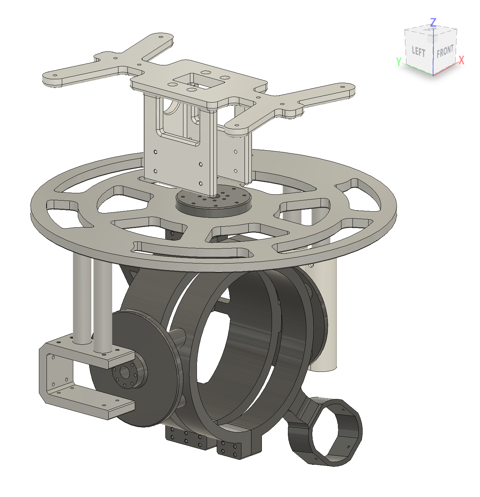 | 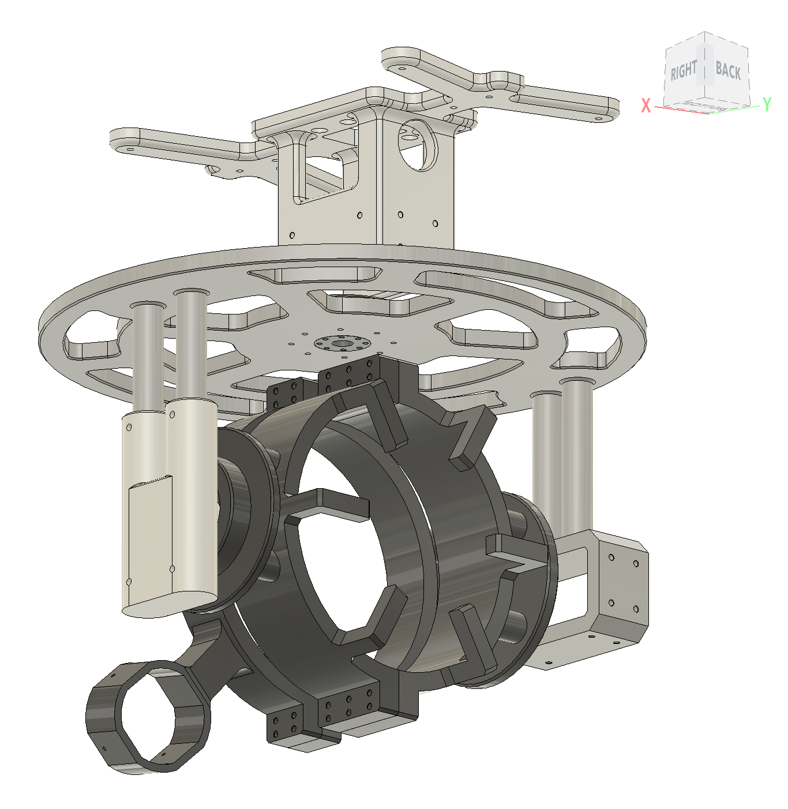 |

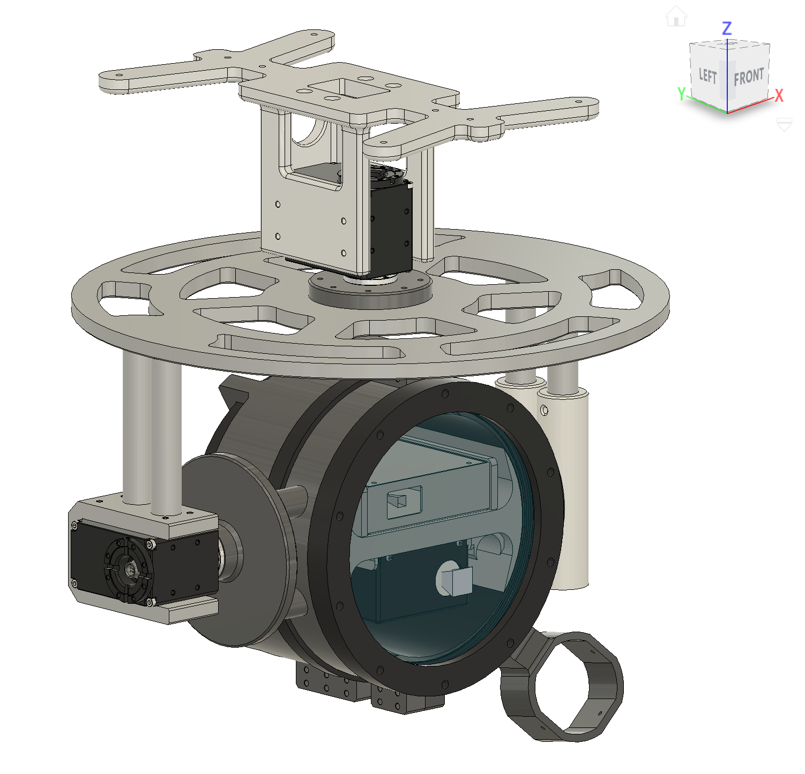

### Fabricated assembly

| Physical installation | Underside view |
|---|---|
| 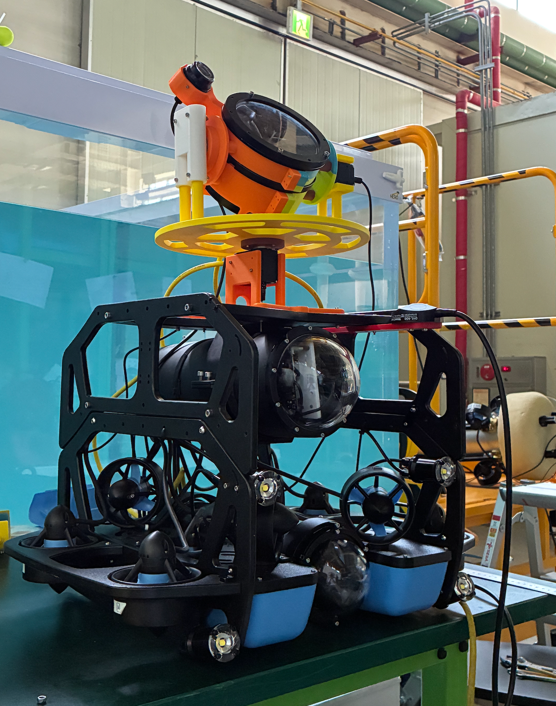 | 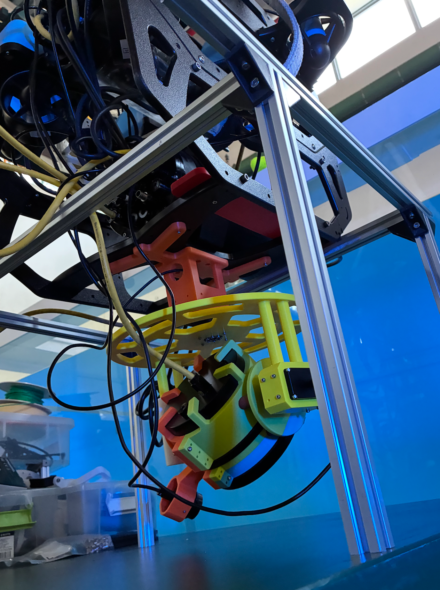 |

### Underwater operation

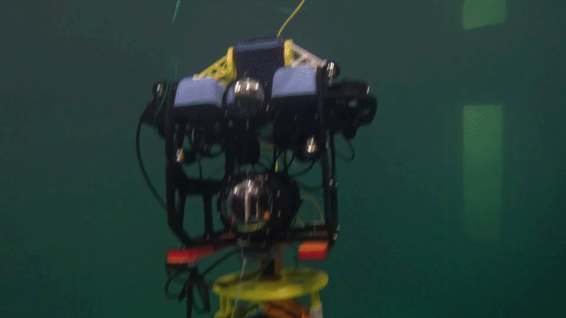

The GIF above provides an inline demonstration. [Watch or download the full-resolution underwater operation video (MP4)](media/videos/bluerov2_lasermodule_video1.mp4). The MP4 is tracked using Git LFS.

**CAD:** Six individual STEP component models are provided under the [laser-camera-pan-tilt module](modules/laser-camera-pan-tilt/).

| File | Component |
|---|---|
| `laser_module_bearing_link.step` | Bearing link |
| `laser_module_ceiling.step` | Upper attachment |
| `laser_module_disc_link.step` | Disc link |
| `laser_module_disk.step` | Circular disc |
| `laser_module_left_part.step` | Left component |
| `laser_module_right_part.step` | Right component |

## 2. Modular Oculus M1200d Imaging Sonar Mount

A modular, truss-supported mounting structure for the **Oculus M1200d imaging sonar**. The design uses separate left and right support components and accommodates reconfiguration between **45° and 90° sonar beam orientations**.

**Design considerations:** Providing a rigid sensor interface, arranging the support and truss components around the sonar housing, and enabling alternate mounting orientations without redesigning the entire module.

### CAD design

| Sonar mounting assembly | Truss and interface details |
|---|---|
| 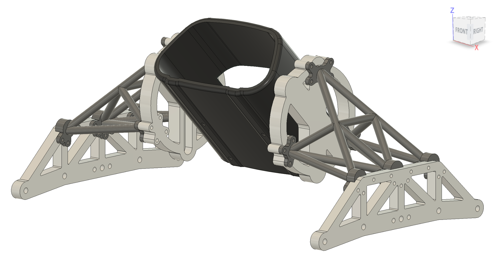 | 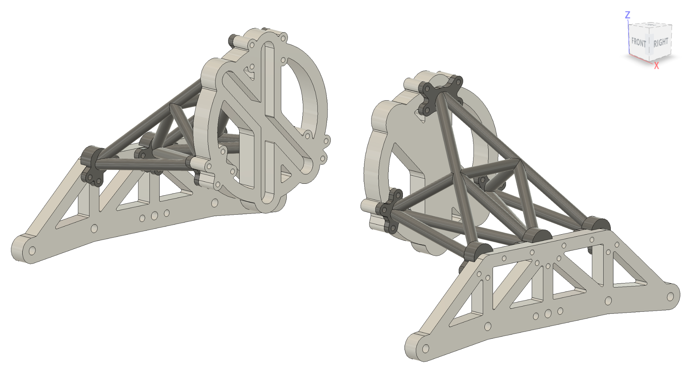 |

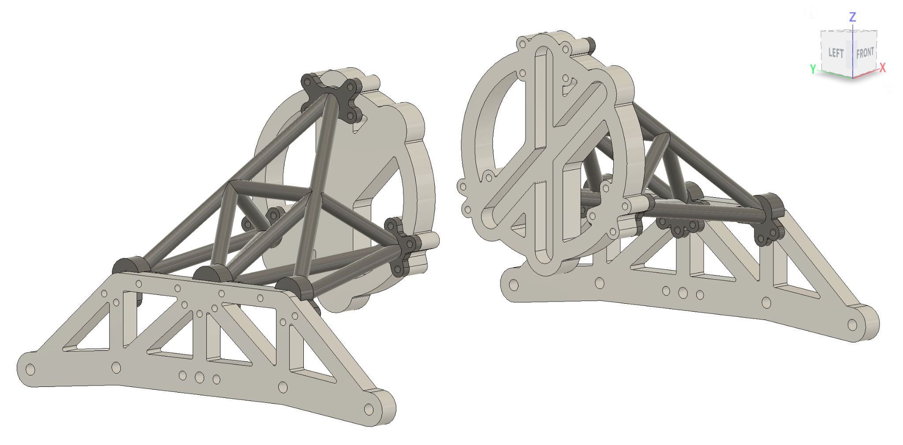

### Fabricated assembly

| Installed sonar mount | Alternate integration view |
|---|---|
| 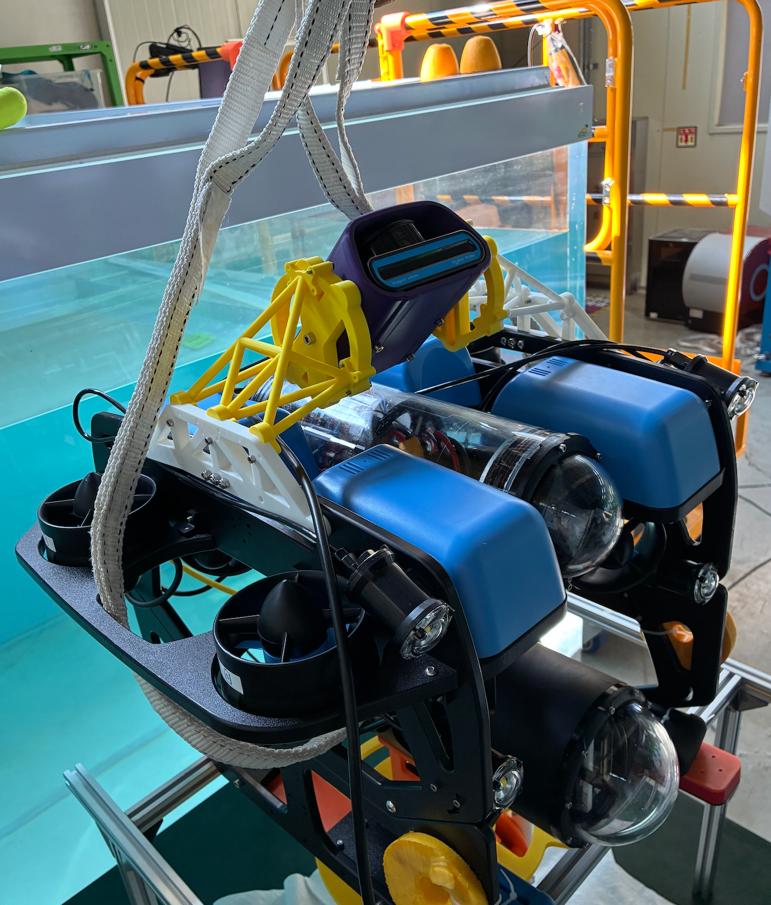 | 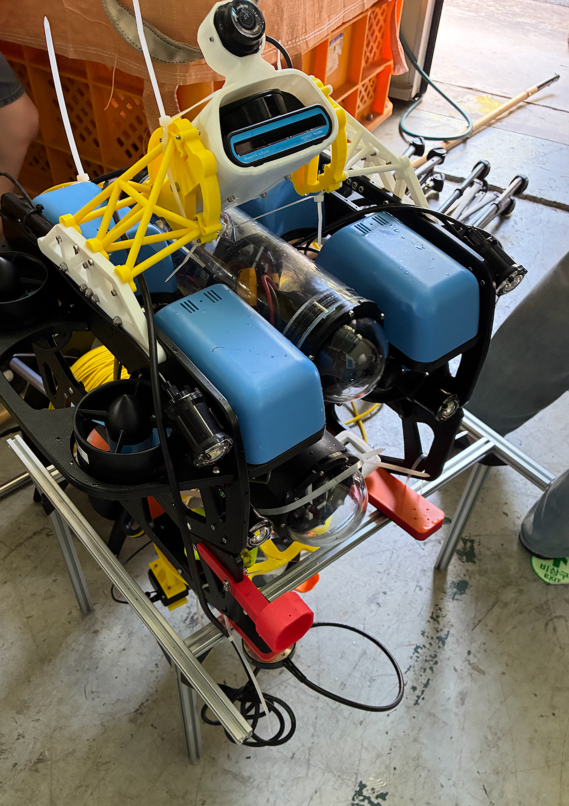 |

**CAD:** Seven individual STEP component models are provided under the [sonar-mount module](modules/sonar-mount/).

| File | Component |
|---|---|
| `sonar_module_left_disc.step` | Left disc |
| `sonar_module_left_support.step` | Left support |
| `sonar_module_left_truss.step` | Left truss |
| `sonar_module_right_disc.step` | Right disc |
| `sonar_module_right_support.step` | Right support |
| `sonar_module_right_truss.step` | Right truss |
| `sonar_module_sonar_cover.step` | Sonar cover |

## Integrated BlueROV2 Assembly

| Front CAD view | Rear CAD view |
|---|---|
|  | 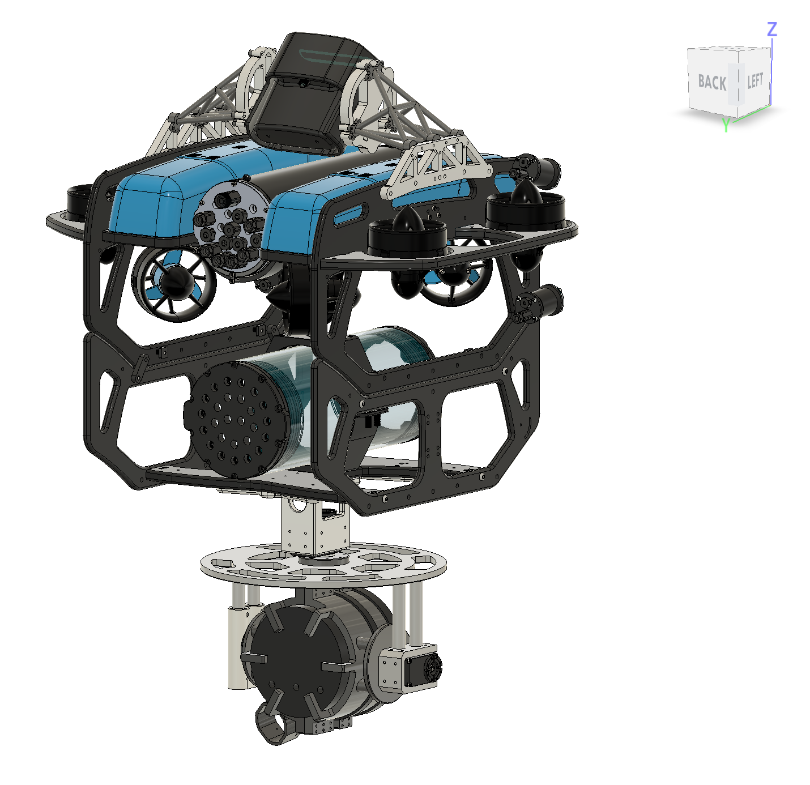 |

The two modules are documented together because they share the BlueROV2 integration platform. The provided STEP models represent individual parts; no verified native, constrained CAD assembly is included.

## Repository contents

- `modules/laser-camera-pan-tilt/` — laser camera mount component models
- `modules/sonar-mount/` — sonar mount component models
- `media/renders/` — module and integrated-platform CAD images
- `media/photos/` — fabricated hardware and integration photographs
- `media/videos/` — underwater demonstration media (large MP4 files may use Git LFS)

## Outcomes and scope

Both designs progressed beyond CAD to fabricated mounting hardware and physical integration with BlueROV2. The laser-camera project also includes underwater demonstration footage. The sonar mounting concept supports alternative 45° and 90° orientations; the available documentation does not establish that both configurations were separately validated underwater.

## Engineering notes

The images and footage document fabrication, installation, and underwater operation. They do **not** establish quantitative positioning accuracy, structural strength, environmental rating, sonar performance, or full validation of every configuration. Actuator specifications, material selections, and test measurements should only be added when verified.

## Attribution and permissions

Developed during a research internship at **POSTECH HERO Lab**. BlueROV2 and Oculus M1200d are third-party platforms/products. Publication and reuse of the CAD and research media are subject to permission from the appropriate rights holders; see [LICENSE-NOTICE.md](LICENSE-NOTICE.md). No open-source license is granted by this repository.
